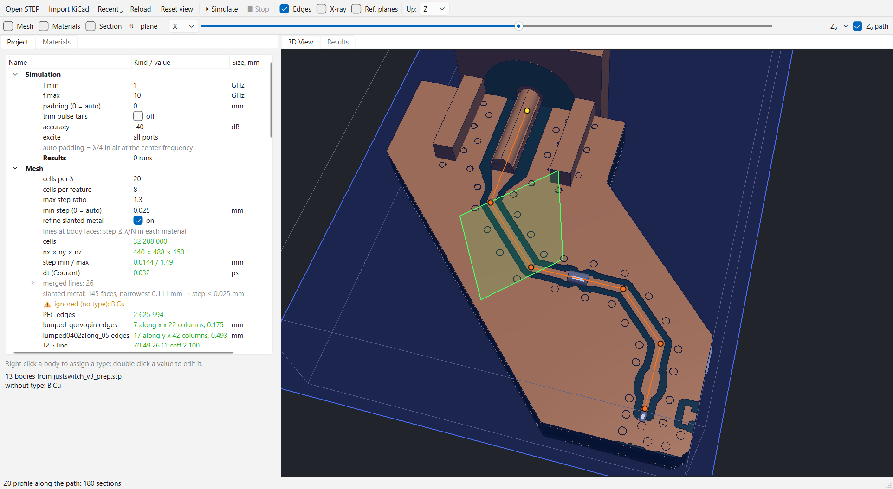
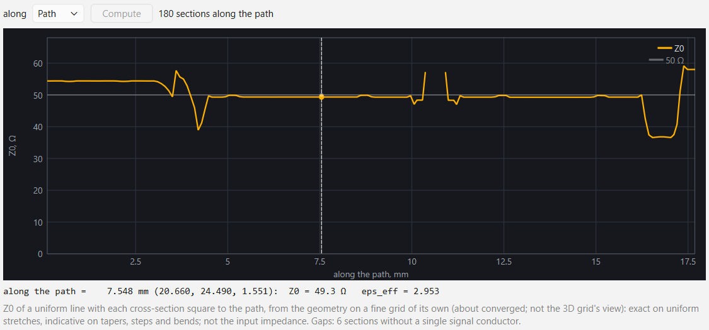
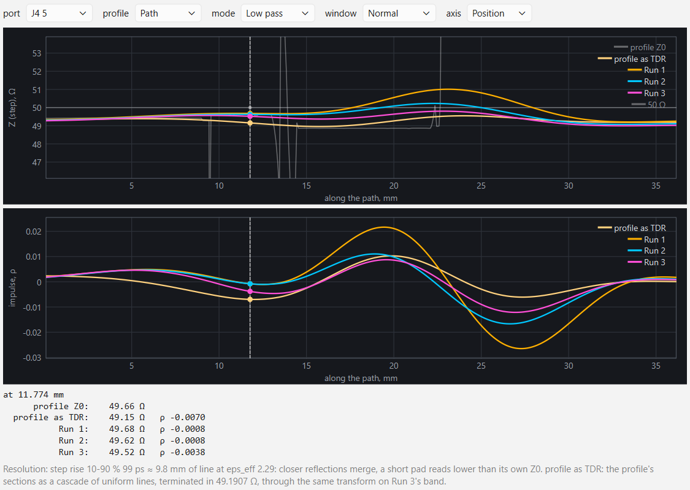

# customcst — architecture

The second, more serious pass after `../pseudo_cst_3d`. Differences:

- **Two grids.** The *compute grid* is non-uniform rectilinear (tensor product
  of x-, y- and z-lines with variable spacing, as in CST's hexahedral mesh and
  openEMS). The *display grid* is uniform, as in pseudo_cst_3d; fields are
  resampled from one to the other.
- **Real units.** SI everywhere inside (m, s, F/m, H/m, S/m, Ohm). The UI and
  model files use mm / GHz / ns, like CST.
- **Geometry from STEP**, with materials assigned to bodies.

## Levels (built bottom-up)

Each level talks to the next through plain data (numpy arrays + dataclasses).
Only level 0 knows about OpenCASCADE.

| # | Level | Input -> output | Status |
|---|---|---|---|
| 0 | `geometry/` CAD import | STEP -> `Geometry` (bodies: triangles in m, name, kind solid/sheet, color) | **done** |
| 1 | `project/` model | Geometry + object types per body (materials, later ports) + frequency range + boundaries -> `Project` (`model.step` -> `model.toml`) | types PEC / Dielectric done; ports, setup next |
| 2 | `mesh/` compute grid | Project -> `RectilinearGrid` (x[], y[], z[] node lines): fixpoints at body boundaries, max step λ_min/N in each material, grading ratio limit | **done** (first version) |
| 3 | `discretize/` "parser" | Grid x Geometry -> material arrays on the Yee grid (ε, σ on E-edges; μ on H-edges; PEC edge mask; later edge fill fractions for conformal FDTD) | **done** (staircase) |
| 4 | `solver/` FDTD | Material arrays + excitation -> fields in time; non-uniform Yee, CPML, lumped ports with R. Pluggable: openEMS can consume the same grid | **done** (first version) |
| 5 | `monitors/` | Port V/I -> Z(f), S11; DFT field monitors at chosen frequencies; later far field | S-matrix, Z_in done (`solver/sparams.py`); field monitors next |
| 6 | `view/` display | Compute grid -> uniform display grid -> slices, heatmaps, arrows (reuse pseudo_cst_3d layers) | geometry view done |

## Plan (open items)

1. **Wideband dielectric losses.**
   - Today a dielectric's loss is a constant conductivity
     σ = 2π f_ref ε0 εr tan δ, exact at f_ref only. The effective tan δ
     falls as f_ref / f: FR4 fitted at 3 GHz loses half its tan δ at
     6 GHz.
   - Real laminates have an almost flat tan δ over decades, and εr falls
     slightly with frequency (FR4: ~4.4 low, ~4.2 at 5-10 GHz). This is
     the Djordjevic-Sarkar model.
   - Plan: a dispersive dielectric in the FDTD, a sum of a few Debye terms
     (auxiliary differential equations per edge), fitted to a flat tan δ
     and the εr(f) slope over the band.
   - The material presets get the model parameters (εr and tan δ at a
     frequency, or wideband).
   - Check: the effective εr and tan δ extracted from a simulated line
     over 1-10 GHz.
   - Until then: put f_ref in the middle of the band (a warning says when
     it is outside).
2. **Mesh: narrow gaps and curved faces.**
   - The merge distance (thin copper collapses onto one line) and the
     smallest cell are the same `min_step` today. With the automatic value
     (≈ λ/200) a 0.4 mm coplanar gap gets 2-3 cells: Z0 53 Ω instead of
     about 62 Ω.
   - Plan: separate them, so thin copper still merges but gaps get
     `cells_per_feature` cells.
   - Done: fixpoints only from planar CAD faces (`Body.planar`, from the
     OCP surface type; vias: caps only). Facets of a tessellated bore
     normal to the axis had chained the merge and pulled a 15 um inner
     ground 7 um off its face. Copper between two dielectric layers sits
     on the thinner layer's face (`check_mesh`, the 4-layer stack).
3. **Field monitors** (level 5): DFT fields at chosen frequencies on the
   display grid, then far field.

## Key decisions

**Where the material values live (level 3).** Not "at grid points": each
quantity lives where the Yee scheme uses it.

- ε and σ: on E-edges (an edge-averaged value: the 4 cells around the edge).
- μ: on H-edges (through the face centers of the primary grid).
- PEC: a mask that forces E = 0 on edges.

The solver only sees per-edge update coefficients (Ca, Cb, Da, Db), as in
pseudo_cst_3d, but now with per-edge lengths and dual lengths.

**"Hollow" bodies.** This depends on the material:

- **PEC and good conductors at GHz.** The skin depth in copper at 2.4 GHz is
  1.3 µm, far below any cell, so only the surface matters. We mark the E-edges
  on (or nearest to) the surface as PEC. Filling the inside gives the same
  answer, because no field gets in. Working with the surface is still the
  right model, for two reasons:
  - it handles thin sheets (35 µm copper, zero-thickness STEP faces) that
    fall between grid lines;
  - it leads to a surface-impedance model for finite σ later.
- **Dielectrics are never hollow.** The field fills them, so ε applies over
  the whole volume.
- **Lossy dielectrics** use a volume σ, or a loss tangent tan δ at a reference
  frequency.

**Grid lines vs geometry.** Levels 2–3 work with the triangles only, never
with OCP. The main operation is "where does a grid line cross the surface":
every edge lies on a grid line. That gives inside/outside along each edge
(staircase) now, and the exact crossing point (conformal / PBA-style
fractions) later, from the same intersections.

**Time step.** In a non-uniform grid, the smallest cell limits dt (Courant).
That is why the mesher limits the smallest step and the grading ratio.

**Local refinement.** Here this means "lines are denser in some places", and
those lines run through the whole domain. True subgridding (refining only a
local box) is much harder and is out of scope for now.

## Level 4 (first version)

`solver/fdtd.py` `FdtdSolver(materials, f_min, f_max, active_port)` (the
equations are in the header).

- **Scheme.** SI units, Yee on the non-uniform grid. curl E uses the
  primary steps, curl H the dual steps (half sums). The outer faces are
  PEC.
- **CPML.** 8 uniform cells outside the meshed domain, with the step of the
  outermost cell. Materials are edge-replicated into the CPML, and the
  profile is sigma' = 0.8 (m+1) c0 / step · d^3.
- **Lumped port.** V_s in series with R, spread over the port column:
  sigma_e = L / (R A_e) and J_e = sign V_s / (R A_e). V and the gap current
  I (H circulation, mean over the column) are recorded every step at their
  own times.
- **Pulse.** A sine-modulated Gaussian, f0 = band center, 20 dB down at
  f_min and f_max, no DC.
- **Run.** Stops when the electric energy is 40 dB below its peak, or after
  30 pulse lengths.

Post-processing is in `solver/sparams.py`: power waves with reference R,
S_jk = b_j / a_k, Z_in = V / I.

VNA view (`solver/vna.py`, no Qt; `view/results_panel.py`,
`view/smith.py`): all from the S-matrix of one simulation, no re-run.
- Formats: LogMag, Phase, Group delay (-dφ/dω, unwrapped), SWR, LinMag,
  Smith and Z in. SWR, Smith and Z in show reflection traces only.
- Traces S_jk are checkboxes; S11 and S21 are on by default.
- A frequency marker reads out dB, phase, SWR and Z = R(1+Γ)/(1-Γ), with
  the series L or C equivalent.
- "Save .sNp" writes Touchstone v1 (RI, GHz, one reference R).
- `checks/check_vna.py`: hand cases for Γ, SWR, L and C, the group delay of
  a pure delay, and a Touchstone round trip.

UI: "▶ Simulate" runs one solver per port in a QThread
(`view/sim_runner.py`), so S-matrix column k comes from exciting port k.
The Results dock (`view/plot.py`, QPainter) shows |S| in dB or Z_in.
"■ Stop" aborts. Results are not saved yet.

Speed (NumPy, float32): about 3 ms per step for 127 k cells. The test line
takes 2300 steps, about 9 s per port.

Validation:
- `checks/check_fdtd_cavity.py`, a PEC cavity on a graded grid (step
  ratio 1.12), compared with exact values:
  - TE101: +0.30 %;
  - fully filled with εr = 4: +0.6 %;
  - half filled along x, against the transcendental solution: +0.6 %;
  - energy is conserved to 1 %.
- `checks/check_fdtd_line.py`, the 50 Ω microstrip:
  - εeff of the line alone (from two lengths, so the port parasitics
    cancel) is within 1.9 % of Hammerstad-Jensen + Getsinger over
    1–5 GHz, dispersion included;
  - S21 = S12 and S11 = S22;
  - no gain beyond 2 %, and up to 5 % loss at 5 GHz, likely radiation (not
    verified);
  - |S11| < -12 dB.
  - The 50 mm line alone shows about 0.02 ns more delay than the bare
    line: that is the lumped ports' own L and C, as with CST's discrete
    port.

Lessons:
- Do not divide the resonance spectrum by the pulse spectrum near the band
  edges.
- The quasi-static series-capacitor formula is not exact for a layered
  cavity whose layers are not thin.
- Pick the 2π branch explicitly when unwrapping long lines.

## Holes and vias

**Body holes** (`step_io._holes`, exact CAD faces): cylindrical faces whose
outward normal (out of the material) points toward the axis.
- Half faces on the same axis, radius and range are joined.
- Only a full turn counts.
- Stored per solid in `Body.holes`, (H, 8): start, axis, radius, length.

**Model holes** (`geometry/holes.py find_holes`, numpy):
- A body hole counts when it is:
  - through: no material of its body just beyond either end, on the axis;
  - open: the middle of its axis is inside no other solid. So a connector
    bore with its dielectric, or a coax shield, is not a hole.
- Holes of different bodies on one axis line, with the same radius and
  touching ranges, are one hole: the drill through FR4 and both coppers.
- A different radius stays separate: a ground clearance (antipad) must not
  touch the via.
- Ids are H1, H2 ..., by diameter, then position.

**UI**:
- a "Holes" section in the tree, with groups by diameter and one row per
  hole (center in mm, the bodies it passes);
- selecting the section, a group or a hole draws the outlines plus a halo
  ring in cyan, through the bodies. The info panel shows the details.

**Why holes in the substrate do not matter**: a via drawn in a drilled hole
and a via over solid substrate give identical solver materials, because
metal cells are left out of the edge εr mean (`check_discretize`).

Checks: `checks/check_holes.py` uses a built board:
- vias through FR4 and both coppers;
- a via through an antipad;
- a mounting hole;
- a blind pocket and a filled hole, which are excluded;
- a hole made of two half faces.

None of the user's models has an open hole.

**Vias**: holes are assigned in the project TOML.
- `[holes.diameters]` holds rules by drill in mm (`"0.4" = "via"`).
- `[holes.single]` holds rules by center in mm (`"-3,0,0.8" = "none"`).
  They beat the diameter rule.
- Kinds are "via" or "none"; without a rule a hole stays open.
- Matching tolerances: 0.1 µm for a drill, 1 µm for a center.
- `Project.vias(holes)` gives the assigned holes. `holes.via_body(hole)`
  builds the closed 48-gon PEC cylinder that fills one.
- These cylinders are extra conductors in `build_grid(..., vias)` and
  `discretize(..., vias)`. The STEP bodies stay untouched.
- The results fingerprint includes the hole rules.

UI:
- right click on a diameter group: "Via: all ⌀ …", "Not via", "Remove
  the diameter rule";
- right click on a hole: "Via", "Not via", "Use the ⌀ … rule";
- the tree shows the counts, "via" on via rows (gold) and "*" for a
  hole's own rule;
- vias are drawn as gold pins.

`checks/check_vias.py` covers:
- the rules, their round trip, bad rules and the fingerprint;
- a PEC column through each via, with excluded and mounting holes open;
- top and ground stay apart through an antipad via, and are joined by a
  via through the ground (3D connectivity of the PEC edge graph);
- recognized vias against the same vias drawn as PEC cylinders: identical
  PEC edges (0 of 3478 differ).

## KiCad import

Toolbar > Import KiCad (`geometry/kicad_step.py`): a KiCad board STEP
(File > Export > STEP) becomes `<name>_prep.stp` next to it, in the form of
our Inventor models, and is opened the normal way; the types are assigned
by hand. The usual Open STEP path is unchanged.
- KiCad puts each category in its own part: `<board>_PCB`, `_copper`,
  `_pad`, `_via` (`_soldermask`, `_silkscreen` when enabled). They are told
  apart by these names, never by shape. The footprints' 3D models lose
  their body names (`COMPOUND`): their solids are named by the reference of
  the instance above them (`J2 1`, `J2 2` ...).
- Copper: solids grouped by z range into layers, top down F.Cu, In1.Cu ...
  B.Cu. Pads are exported 5 um thicker than the copper (40 vs 35 um), which
  would put a 5 um cell into the mesh: each is cut to the z range of the
  one layer it overlaps and fused into it (a pad through several layers
  stays a body `pads`). A layer is fused into one shape with its touching
  faces merged (ShapeUpgrade_UnifySameDomain).
- Vias: one body `vias`, typed PEC by hand (no hole rule; the board's via
  holes would add a second copy). Board: `board`.
- **Every via is a through via (a simplification for now).** Each via is
  rebuilt as a solid copper cylinder of its drill from the bottom of B.Cu
  to the top of F.Cu, whatever KiCad drew: blind and buried vias (outer
  to inner layer, inner to inner) and micro vias become through vias too.
  The import report counts them ("N blind or buried, made through"). A
  board that relies on them (a via that must not reach the other side)
  is not modeled right yet.
- Plated holes as tubes: KiCad draws a via either solid or as its plating
  (outer radius = the drill, inner = the drill minus 2 x 25 um), depending
  on the export, and a footprint's plated hole (a via in a footprint, a
  through-hole pad) as such a tube among the pads plus a ring on each
  layer. Every round via, and every round pad through several layers (one
  or two coaxial vertical cylinders, horizontal ends), becomes the through
  cylinder of its outer radius in `vias`; the rings join their layers.
  Same conductor from outside, no 25 um wall for the mesh, and a footprint
  via gives the same column as a board via of the same drill. A plated
  hole in the pads with no hole of its outer radius in the board on its
  axis is reported (KiCad drills the board for pads, not for vias). The
  test board exported both ways (pcb_solidvia, pcb_holesvia) and the older
  export (pcb): 21 / 21 / 22 columns of 0.1117 mm3 each.
- Footprints left out of the board: KiCad exports the pads and vias of
  every footprint, also of those put beside the board and disabled. A pad
  or via more than half outside the board's outline is dropped: the outer
  wire of the board's top face, extruded through all z (holes left out),
  and the part of each solid outside it by volume (BRepAlgoAPI_Common).
  One partly outside is kept and reported: a via fence along a slanted
  edge reaches a little past it. Copper outside the outline is reported,
  not cut. The real board (real_sim): 265 of 366 pads and 115 of 137 vias
  dropped, one fence via 9% outside kept, ~1.5 s.
- A layer's disjoint pieces (pour, a trace in its clearance) are one body:
  each solid is written named like its part, and read_step merges solids
  named like their part (Inventor names a part after its file and may
  repeat body names inside it, so its parts are unaffected). OCC's writer
  leaves solid names empty: they are filled into the MANIFOLD_SOLID_BREP
  entities in writing order and checked by reading the file back. Each
  body is written as a compound (a located solid alone becomes an instance
  of an unnamed part, 'SOLID').
- A multi-piece body keeps its solids as `Body.pieces`: the PEC closure
  of discretize (`_close_metal`, every edge between two metal nodes of a
  conductor is PEC) runs per piece. Run per body it bridged the gap at a
  trace's rounded end (one cell wide at min step 0.08) and shorted the
  trace to the pour: the first KiCad runs reflected everything.
  `check_kicad` builds such a board and sees the short when the pieces
  are dropped. A gap narrower than a cell is still not resolved: then the
  two pieces share nodes and are joined (that is the grid, not a bug).
- The test board (4 layers, SMA, 10 vias): 27 KiCad solids -> 9 bodies in
  1 s; F.Cu is 2 pieces (pour, trace with the pin's pad).
- Re-importing keeps the `_prep` project file: bodies with the same names
  keep their types, new ones come untyped, gone ones are removed from it
  (a plain Open STEP keeps them as orphans). The
  model parts are numbered in KiCad's order, so a body added to a model
  renumbers the others and a type would land on another part: the report
  lists the bodies whose bounds or volume changed under the same name
  (`compare_bodies`), new and gone ones. A second import of the same file
  reports no change.

## Application settings

`app_settings.py` keeps the settings of the program itself, not of a
model, in a JSON file: `%APPDATA%\customcst\settings.json`, or
`CUSTOMCST_SETTINGS` for tests.
- `recent_files`: newest first, at most 10. The toolbar has a Recent menu;
  missing files are greyed out, and the menu has "Remove missing" and
  "Clear list".
- `window`: the normal geometry plus `maximized`, written when the window
  closes. It is restored on start; if that monitor is gone, the window is
  centered on the primary one.
- Start: `main.py` opens the given file, else the newest recent file that
  still exists, else an empty window.
- A damaged file gives the defaults and a status message. A bad window
  entry is simply forgotten. Unknown keys are kept on save.
- Checks: `checks/check_app_settings.py`.

## Material library

`project/materials.py` holds the dielectric presets.
- Built-in presets come from the program: Default (εr 1), FR4 (4.3,
  tan δ 0.02 at 3 GHz) and PTFE (2.1, tan δ 0.0002).
- The project's library starts from them and is saved into the model's TOML
  as `[materials.NAME]` tables, so a model keeps the values it was
  computed with. A TOML preset overrides the built-in one of the same name.
- A dielectric body has `material = "FR4"` and a copy of the values (the
  solver reads only the body's values; on load the library wins), or
  "Custom" with its own values. Files without the key load as Custom.
- Editing a value of a preset body by hand makes it Custom. Editing a
  preset updates every body that uses it.
- Library edits (Project methods): add, duplicate (free name "X copy",
  "X copy 2"), rename (the users follow, the order is kept), delete (only
  when unused), set a value, reset a built-in one.
  - Built-in presets can be edited and reset, not renamed or deleted:
    they would come back from the program on the next load.
  - "Custom" is a reserved name.
- UI: the left dock has two tabs.
  - "Project": the tree, with a Material row per dielectric (double click
    picks a preset).
  - "Materials": the library table (values, source: built-in / built-in,
    edited / model, used by). Double click a cell to edit a value or a
    name. Buttons: New, Duplicate, Delete, Reset built-in.
- Checks: `checks/check_project_file.py`.

## Section view

Toolbar > Section: the model is cut by the plane of the mesh slider
(plane ⊥ X / Y / Z, the same axis and position), ⇅ keeps the other half.
For checking a geometry inside the program instead of the CAD tool.
- Every body and via is clipped by a VisPy PlanesClipper (one per visual,
  in the body's own coordinates).
- The cut face: a fill image of the bodies on the plane (ray casting along
  an in-plane axis, `view/section.py`; sampled a hair inside the kept half,
  so a plane on a face shows the kept side's body; dielectrics painted
  first, conductors over them, vias last) and the exact outline of each
  body's triangles crossing the plane (a 15 um layer stays visible though
  it is far below a pixel). ~90 ms for a KiCad board with an SMA; while
  the slider is dragged the fill is coarser (300 px, ~20 ms), full detail
  on release.
- The slider: on the grid lines while Mesh or Materials is shown (that
  plane must be a grid line), else 1000 even steps (a smooth section: the
  grid's lines are up to millimeters apart in the air). Z0 and the
  materials plane take the grid line nearest the plane.
  The fill stays opaque: a translucent one showed the clipped shells'
  empty insides, and the bodies looked hollow.
- The plane itself: light glass, visible from either side and where it
  cuts nothing: the fill image's empty pixels over the model's extent, and
  a frame-shaped sheet out to +5 % around it. The two never overlap
  (coplanar translucent layers z-fight into stripes), and the fill is drawn
  after the bodies: its pixels write depth, so drawn first it hid every
  body behind the plane.
  (VisPy's set_gl_state takes no depth_mask: passing it silently broke
  the drawing of every body.)
- The camera's depth range is 1:200 (VisPy's 1:1e6 made 15 um copper on
  FR4 flicker through).
- `check_section`: fill colors at known points, a plane on a face, the
  outline's length and coordinate.

## Standard views

Buttons over the 3D view's top right corner (`view/view_buttons.py`, a
child of the canvas widget, a 3 x 3 grid of equal buttons: Iso, Top,
Back / Left, Front, Right / Ortho, Bottom): Top, Bottom, Front, Back,
Left, Right, Iso (= Reset view) and Ortho.
- A view resets the camera to the model as Reset view does and looks
  along an axis (`GeometryView.look_from`). Top is from +up; the sides
  follow the CAD habit for the up axis (z up: Front from -Y, Right from
  +X, Top with X right and Y up; y up: Front from +Z, Top with X right and
  -Z up; x up: Front from +Z, Right from -Y).
- VisPy's turntable maps its azimuth through the up axis, so each view
  tries the 12 axis-aligned (elevation, azimuth) pairs and keeps the one
  where the side's direction does not move on the screen and comes nearer,
  and the axis meant to point up the screen does.
- Ortho: fov 0 (no perspective; 30 degrees otherwise), a flat top view to
  draw a Z0 path on. Path clicks land within a pixel there too (the ray
  comes from the transform's inverse at two depths). Not saved with the
  camera.
- The buttons take no focus (Space keeps panning).

## Picking points (for measurements)

A left click without a drag (press and release within 4 px) picks a point
in the 3D view; a drag still rotates. Two points, A and B:
- a click sets or moves A (yellow), Shift + click sets or moves B (cyan);
  Shift + drag still pans. A click on nothing changes nothing;
- a double click on nothing, or Esc, removes both;
- a line joins A and B; the status bar shows each point (kind, body,
  coordinates) and |AB| with dx, dy, dz.
- `view/picking.py` (numpy only) snaps like CAD measuring tools:
  1. a CAD vertex within 8 px (`Body.corners`: the ends of the CAD edges,
     stored at import);
  2. else a point of a CAD edge within 6 px: the edge's point closest to
     the ray through the click (exact in perspective; the screen fraction
     along an edge going into the depth was off by 0.5 mm on a 10 mm box);
  3. else the point where the ray through the click enters the first face
     (Möller–Trumbore over all triangles, ~5 ms on the KiCad board).
- A vertex or edge point must be visible: no face between the camera and
  it, up to 2e-4 of the model size (an edge lies on its own faces). X-ray
  and the materials view pick through the bodies. Hidden bodies and the
  removed half of a section are skipped (the cut face is not pickable yet).
- The camera comes in as VisPy's visual -> canvas transform (`map` for the
  pixels, `imap` at NDC z = -1 and 0 for the ray).
- Next: point-edge and edge-edge shortest distances.
  `checks/check_picking.py`.

## Line impedance (Z0 at a plane, Z0 profile)

Toolbar > Z₀ (`solver/line_profile.py`, `view/profile_window.py`): the
waveguide port's 2D quasi-TEM solver run on any grid cross-section, like
CST's 2D port solver or a TDR picture.
- Click: Z0 and eps_eff at the mesh plane, in the status bar. The arrow
  menu: the profile along the plane's axis, every grid line inside the
  model (~2 s for 90 sections of the SMA + 4-layer board), in a tool
  window: Z0 curve, a 50 Ohm guide, a marker tied to the mesh slider both
  ways (the wheel over the plot moves the 3D plane). Opening the window
  computes nothing: its Compute button does. Each axis's profile is kept
  until the mesh changes (reopening shows it again); after a remesh the
  open window says outdated and Compute is enabled again.
- Computed profiles are saved with the runs (`solver/profile_file.py`:
  `model.results/z0profiles/x.npz` ... `path.npz`, one per source) under
  a key: the results' fingerprint (STEP bytes, body types and values,
  hole rules, [simulation] / [mesh]: all the mesh is made of), the
  source, the Z0 path for the path's one, a format version. A new mesh
  starts with the ones whose key matches, so a model reopened unchanged
  shows them without a Compute (the justswitch input's X profile: 68 s
  once). Another key: not loaded, overwritten by the next Compute; a
  damaged file: not loaded. `check_profile_file`: round trips (axis,
  path), the key's parts, a damaged file, the run listing unaffected.
- The model's extent on the plane picks the conductors: what reaches its
  side is ground, the one other conductor is the signal. Where nothing
  reaches the side (a connector's shell beyond the board), the metal's own
  extent on the plane is used instead.
- What joins out of the plane counts too (`pec_nets`: the 3D pieces of
  metal, found once per mesh): a conductor tied to a ground elsewhere (a
  GND pin to the pour, a chip's paddle on its vias) is ground; the signal
  is the conductor a port, an element or a wave port is on, other ones
  float (zero net charge: a chip's unconnected pins beside the signal
  pin). Without it a section through a chip footprint had 2-4 "signal"
  conductors and no Z0. With no port in the model the single other
  conductor is the signal, as before. A driven line joined to the ground
  elsewhere (a short) has no signal, with that reason. Convergence slabs
  take the nets of the 3D grid's nearest nodes.
- It is the impedance of a uniform line with that cross-section: exact on
  uniform stretches, indicative on tapers and steps, not the input
  impedance. Sections with no signal or several (a lumped element beside
  the trace) are gaps with the reason.
- Model 08 showed with it: pin over the board 50 Ohm, the 1 -> 0.3 mm
  taper over the L2 window 60-70 Ohm, the 0.3 mm line 48 Ohm (the grid
  put one gap at 0.2 instead of 0.25 mm), the model's coax 46.2 Ohm.
- Z₀ convergence at the plane (arrow menu): the same plane on grids of its
  own, cells per feature 4, 8, 16 (32 if 16 has not converged), the merge
  distance scaled as 1 / level; each is the project's grid at that setting
  cut to a two-cell slab around the plane, so the 3D grid is untouched and
  only the plane is discretized (~3 s on the SMA board). The answer: the
  mean of the last two levels +- half their difference, converged within
  1 % (the staircase converges unevenly). It found the 0.3 mm trace of
  the KiCad test board at 54 Ohm where the 3D grid (4) saw 51.7, and the
  0.35 mm one at 49.5 (seen as 47.2).
- `check_line_profile`: coax in a wider block (the fallback), Z0 within
  1.5 % of 60/sqrt(eps) ln(D/d), eps_eff, no-signal sections, one plane
  = the profile; convergence within 1 % of the analytic value.
- `check_line_nets`: a microstrip with a via-tied pad and a free pad beside
  it: no Z0 on the plane alone, with the nets Z0 below the bare line's,
  the via in the plane gives the same within 1.5 %, removing the free pad
  raises Z0 by < 3 %, a short beyond the plane and a model with no port
  give their reasons.

### Z0 along a drawn path

A profile along an axis cuts a diagonal trace obliquely (45 degrees reads
~15 % low). The Z0 path (`solver/path_profile.py`) is a polyline the user
clicks in the model, and its cross-sections are square to every segment.

The justswitch board (KiCad): the path from the connector pin, around the
bends and over the series capacitor to the switch pin, in orange; the
path's plane (the top copper) in translucent blue; in green the section
window under the profile's marker (half_width 2 mm to either side, the
model's whole height), on the first diagonal at 7.5 mm.
Its profile: the straight runs and the diagonals at 49.3 Ohm, the
narrowing at the switch 36.8 Ohm, the switch pad 58 Ohm; the gap is the
capacitor (its metal joins the ground elsewhere: no signal there).

- Project `[z0path]`: `axis` (the plane's normal, x/y/z: a plain STEP may
  lie in any orientation), `at` (mm), `half_width` (mm, default 2),
  `points = [[u, v], ...]` (mm, the other two axes in order). One path per
  model. A model without it gets the default on open: the up axis, the top
  of the first body in the tree (F.Cu on a KiCad import), no points; the
  user corrects the height in the tree ("Z0 path" after Mesh). It is a
  display tool like `[view]`: not in the results' fingerprint.
- Toolbar (second row, with the plane and Z₀) > Z₀ path switches the 3D
  view to path mode (the line in orange, the first point in yellow, the
  path's plane translucent blue over the model, like a reference plane): a click in the plane appends a point,
  Shift+click inserts one into the nearest segment (within 8 px),
  Ctrl+drag moves a point (the camera stays still), double-click deletes
  one. No snapping to the trace: an imperfect path is fine, the
  cross-section only has to cross the trace. Every edit saves the project
  and drops the kept path profile.
- The profile window's "along" box picks X, Y, Z or Path (it replaced the
  plane's axis as the profile's axis). Each source keeps its own profile
  until the mesh (or the path) changes; Compute computes it, with a
  progress bar (along the path first each segment's grid and
  discretization, then the sections done of all). The wheel
  over a path profile moves the section window in 3D to its
  section: a translucent green rectangle square to the path, half_width
  to either side and the model's whole height, i.e. what one section takes
  in (shown from two points on, at the path's start until a profile's
  marker moves it).
- Each segment is solved in a frame of its own (the model rotated so the
  segment runs along the third axis) on a fine grid of its own
  (CELLS_PER_FEATURE 16, the merge distance scaled), one discretization
  per segment; the sections are at the faces square to the segment, at
  least 0.02 mm and at most 0.1 mm apart, none at a vertex. Each reaches
  `half_width` to either side; the conductors cut by its sides are ground.
  A window rides along the path: each segment is gridded and discretized
  only in the box `half_width` across and beyond its ends, over the
  model's whole height (cut in height too, an SMA's coax above the board
  lost its shield's top: 59 Ohm for 49) (`build_grid(..., region=...)`: the domain ends there,
  the slanted refinement looks only inside; bodies outside are dropped).
  A section equal to the previous one (the same edges and nets, a uniform
  run) reuses its answer.
  A segment is discretized in chunks up to 2 mm long (CHUNK_LENGTH): as
  one box, test_prep's 22 mm straight run with a 4 mm window needed
  +7.3 GiB (two runs side by side ran out of memory); in chunks +1.05 GiB,
  the same time and the same profile bit for bit.
  The nodes take the 3D nets of the nearest nodes of the 3D grid, rotated
  back. So it reads about the converged Z0, not the 3D grid's view.
- `half_width` must reach the ground: what the window's side cuts is
  ground, but a side in the gap between the signal and its ground leaves
  that ground out. On test_prep's SMA launch (legs ~3.25 mm from the pin)
  2 mm read 54.5 Ohm for 49.2 (the plane's convergence); 4 mm reads 49.7.
- Speed (idle CPU), justswitch_v3 (KiCad board, 5 segments, 18 mm, 180
  sections): 147 s on the whole rotated board; 64 s with the window (Z0
  within 0.4 Ohm, mean 0.007); 36 s with the discretization on numba
  (the same profile bit for bit); 51 s with the window over the whole
  height (within 0.13 Ohm): the solves (two SuperLU solves a section,
  ~0.05-0.1 s each), the discretization (now mostly the triangle-line
  crossings, numpy), the grids 2 s. Threads do not help the solves (the
  GIL); a loaded CPU (an FDTD run beside it) is several times slower.
- `check_path_profile`: a microstrip, straight and turned 30 degrees: the
  path reads the converged Z0 (within 1.5 %), sections at most 0.1 mm
  apart, flat along the turned line, where the axis profile cuts it > 5 %
  low; a path with a vertex has sections on both segments, none at the
  vertex. `check_project_file` covers `[z0path]`.

## TDR (time domain reflectometry)

Results > TDR… or Z₀ ▸ TDR of the shown runs (`solver/tdr.py`,
`view/tdr_window.py`): a VNA's time domain transform of the shown runs'
S_jj, on the Z0 profile's own axis. No new simulation.

The justswitch input (SMA, 23 mm of CPW, the switch pin as a 50 Ohm
lumped): three runs and the path profile. The pin's inductive doublet at
the path's end (impulse + then -) halves with the lumped's 0.03 pF; the
launch (10-14 mm), deep dips in the quasi-static profile, is flat in all
runs.
- Low pass: the band (uniform, 1-10 GHz in the runs) on its harmonic
  grid, continued down to DC, a Kaiser window over -f_max..f_max
  (Minimum / Normal / Maximum: beta 0 / 6 / 13), the inverse FFT. The
  impulse is scaled so a single reflection reads its rho at the peak;
  the step (its running sum) reads as Z = R (1 + rho) / (1 - rho).
- The continuation to DC is causal: the structure answers only for a
  while (its support: where the band pass envelope, which needs no DC,
  is above 3e-3 of its peak), so the missing bins below f_min are the
  least squares ones that leave the windowed response nil outside it.
  A polynomial fit of the low end (Re even, Im odd in f) failed: a
  reflection 300 ps away turns 2 rad by 1 GHz, and on the justswitch
  input it drew a 70 Ohm bump where the causal one (and the profile) has
  51. A slow tail mostly below f_min (a DC block's RC) is not determined
  by the band: the fit is repeated with a shorter and a longer reach,
  their spread of S(DC) is its uncertainty, and above 0.03 the window
  warns that the step's level drifts (band pass there).
- Band pass: the envelope |rho| over the band alone (any band; behind a
  DC block), no sign.
- Resolution: the step's 10-90 % rise, 99 ps for 10 GHz with the normal
  window, ~1 cm of board line; written under the plot. A 1 mm 60 Ohm pad
  reads 51 Ohm.
- On a profile (one the main window keeps for the mesh: X, Y, Z or Path):
  a waveguide port on it ties the time to the profile's coordinate by
  the sections' eps_eff (`port_origin`, `line_map`: along the port's axis
  its plane; on a path the point nearest the port's center, the way in
  from the port's direction; a coax then a board each at its own speed).
  Without one (no profile, another axis, a discrete port) the axis is the
  round trip time.
- The profile box lists X, Y, Z (and Path when one is drawn) whether
  computed or not. On one not computed for this mesh, the window says so
  and its "Compute Z₀ profile along ..." button computes it (the profile
  window opens with its progress); by default the path's, else the port's
  axis.
- With a profile the window also draws its Z0 (thin) and "profile as
  TDR": the sections as a cascade of uniform lossless lines (pieces of
  at most 0.02 mm, terminated in the port's R) through the same
  transform on the newest run's band. Where a run and it differ, the 3D
  field differs from the cross-sections (a pin, a launch, a lumped).
- The wheel moves the marker over the profile's sections and the 3D
  plane or the path's section with it (the path shows in 3D while the
  window reads along it), as the profile window does.
- `check_tdr`: a single reflection (low pass impulse and step, band pass
  envelope, at its time), S(DC) of a load behind a line and the doubt
  behind a DC block, a 20 mm 60 Ohm line (60 Ohm in the middle, its edges
  at the round trips), the cascade against the exact steps, a 1 mm pad
  smeared, the delays of a coax then a board line, ports on profiles.

## Solver speed (numba kernels)

`solver/fdtd_kernels.py`: the H and E updates (both curl terms, their
CPML, the update) compiled with numba, one pass per field component, the
outer index spread over the CPU cores; also the energy sum of the stop
check.
- CPML memory only in the absorbing layers: a slot map per axis (-1 =
  outside) and psi with that axis compressed.
- Same float32 arithmetic in the same order as the numpy path:
  `check_kernels` finds every field value and port record identical.
- Sources, lumped elements and port records stay in numpy (small).
- Measured on a Ryzen 7 5825U (8 cores), model 07 (1.05 M cells with the
  CPML): numpy 60 ms/step (18 M cells/s), kernels 7.3 ms/step (~140 M
  cells/s), ~8x; the energy check 34 -> 1.6 ms.
- Without numba, or with CUSTOMCST_NUMPY=1, the numpy path runs. The first
  run compiles the kernels (a few seconds); numba caches them in
  `solver/__pycache__`.

The discretization has numba paths too (for the Z0 path's sections first,
the 3D mesh gains as well), bit-identical to numpy (`check_discretize_kernels`
compares every material array on four models):
- `discretize/kernels.py`: the edge average of a cell value in one pass
  over the edges (the numpy path padded the grid and summed four shifted
  copies, four times per field with thick metal skipped);
- `geometry/raycast.py`: the grid queries count each line's sorted
  crossings directly (binary search per point, the lines over the cores)
  instead of searching packed keys (line id + coordinate fraction);
- `_close_metal` (numpy) runs on the block of the piece's nodes, not the
  whole grid, and a piece nowhere near the grid is skipped.
On the board path above the discretization went 41 -> 14 s; on the SMA +
4-layer board's 3D mesh 3.6 -> 1.4 s.

## Mesh rebuild speed and progress

- `discretize` casts each body's rays only over the grid points inside
  its box (plus the PEC reach): before, every body cost a whole-domain
  ray set (~6 s each at 1.8 M cells, even a 12-triangle box; 28 vias were
  161 of 216 s). Model 08 at 1.8 M cells: 216 -> 4 s; 12 M cells: 32 s;
  results bit-identical (all fields compared).
- `discretize(progress=)` reports each step (a body's cells, a conductor's
  edges, the ports). The main window runs it in a background thread
  (one worker, no Qt objects in it): the grid is built at once, then
  `materials` stays None ("the mesh is still being built" for Simulate)
  until a 100 ms timer finds the job done and takes the result in the GUI
  thread. A blue bar in the status bar shows the steps after 0.3 s. An
  edit meanwhile cancels the job (it stops at its next step) and starts
  a new one; a finished result waits while a tree editor is open (the
  rows are rebuilt). The first version ran discretize in the GUI thread
  with processEvents and crashed: the tree's editor could be deleted
  under its own commit. `wait_for_mesh()` for scripts and --screenshot.
- What runs before the background job (in the GUI thread, no bar) was
  18.7 s on the justswitch input after an element's value edit, now
  0.2 s:
  - an element's (or port's) ends: 2001 axis samples, each tested against
    every triangle of every conductor (F.Cu: 10^4 triangles), 16.5 s.
    `points_in_or_on` now takes only the triangles that can matter: for
    the distance those whose boxes reach the points' box (+ tolerance);
    for the ray parity those ahead of the points (the ray runs + in every
    component) whose projections across the ray cover the points' (every
    crossed triangle stays, so the parity is unchanged). The triangles'
    corners and boxes are kept per body. 16.5 -> 0.7 s; and the result is
    kept per body name and conductor set for the loaded geometry
    (`Project.ports/elements(cache=)`): a value edit takes none;
  - the slanted refinement (`_slanted`, 1.8 s) is kept by its inputs
    (a hash of the conductors' triangles, cells per feature, min step,
    the air step, the region; the last 4).
  A type change (another conductor set) or a new mesh setting still
  computes them (~2.5 s there).

## Z0 accuracy of narrow lines

A staircased conductor looks wider near its edges (where the field is
strongest), so a narrow line's Z0 comes out low. 2D study of the 0.3 mm
trace / 0.25 mm gap GCPW over 0.2 mm FR4 (converged 52.4 Ohm, microstrip
without side grounds 54.9, RFcalc 55.06): cells per feature 4: -7 %,
6: -3 %, 8: -1.5 %, 12: -1.1 %. Model 08 at min step 0.05, cpf 4: the
line 48.8 Ohm; at min step 0.02, cpf 8: 52.2. The cells across a feature
are bound by both settings (step = max(feature / cpf, min step)).
- Mesh in the tree: below cells per feature 8 a notice gives the estimate
  (`mesh/rectilinear.z0_error_percent`) and the settings for absolute
  Z0; Z₀ at a plane and the Z0 profile repeat it.
- The interval between neighbouring fixpoints is NOT a feature: lines run
  through the whole domain, so faces of other bodies (vias, other layers)
  cut a trace's width into pieces. A per-feature check needs the
  conductors' own widths and gaps; not done.
- Practice: compare variants at the normal mesh; check absolute Z0 with
  Z₀ at cpf >= 8 (the mesh builds in seconds); a 3D run at that mesh is
  hours (12 M cells, half the time step).

## Shorts on the mesh

A gap narrower than the mesh resolves turns into metal: with min step
auto (lambda / 200 in FR4 at 5 GHz = 0.145 mm) the 0.25 mm gaps of a KiCad
board joined the SMA's pin to its shell, and the run gave S11 = 0 dB.
After discretizing, the nodes joined by PEC edges form pieces of metal
(scipy connected_components, ~0.5 s on 1.7 M nodes):
- a waveguide port whose signal nodes and grounded nodes on its plane
  (PortMode.hot / grounded) are in one piece: "a short";
- a lumped port or element whose two column ends are in one piece:
  shorted / bypassed.
They go to `MaterialGrid.shorts`, shown in red under Mesh; Simulate asks
before running (default No). Not refused: a short can be meant (a shorted
stub, a PIFA's short pin). `checks/check_kicad.py` (the bridged gap is
reported, the resolved one is not).

## Slanted metal (mesh refinement)

A rectilinear grid gets lines only from faces normal to an axis. A trace
at 45 degrees puts none, so its step is the wavelength's (1-3 mm on the
first diagonal KiCad board, real_sim) and the staircase joined the trace
to the pour across its 0.2 mm gaps: the whole top copper was one piece,
the SMA's pin shorted. Other tools: CST's FIT keeps the hexahedral grid
but cuts the cells by the true boundary (PBA, conformal); HFSS and CST's
frequency solver use tetrahedra; openEMS staircases like we do and
advises a fine mesh or axis-aligned routing.

Here (path 1 of two; a conformal update like Dey-Mittra is the other,
bigger one): `mesh/rectilinear.py` step 4, `Mesh > refine slanted metal`
(on by default).
- Each triangle of a planar conductor face not normal to an axis casts a
  ray along its normal, out and in, against all conductor triangles
  (Moller-Trumbore in numpy; ~300 rays x 40 k triangles on the real
  board, under 1 s). Out is the gap, in the metal's width; the feature
  is the shorter.
- Only what can short or what a trace's Z0 needs:
  - the gap counts only to ANOTHER piece of metal (a trace and its pour,
    two pads): only there can the staircase join two conductors;
  - the width counts only to the piece's OWN wall within 15 degrees of
    parallel (a trace's other edge).
  The first rule refined around every slanted metal face: the pour's
  45 degree corners along the board's cut edge, and width rays that
  stopped at a via standing in the pour 0.02 mm away. On the 90 degree
  version of the real board (real_sim_simplify, nothing diagonal in the
  signal path) that doubled the grid, 1.64 -> 3.24 M; now 2.53 M (the
  SMA pad's taper, the clearance cut around the resistor's pad, an island
  of B.Cu 0.2 mm from the ground: whether two pieces are both ground is
  not known when meshing).
- Not counted:
  - hits on faces more than 45 degrees from facing the ray. A ray from a
    triangle next to a corner of a polygonized pour outline hit the
    corner's other wall a few um away;
  - hits nearer than min_step: um notches of KiCad's polygons, not
    resolvable anyway (a real gap that narrow shows as a short);
  - triangles whose spread along their normal's main axis is under
    min_step: KiCad's edges a hair off an axis are straight for the grid;
  - curved faces: their extremes are fixpoints already.
- Along each axis the face's normal has a component on, over its extent
  +- the feature, the step is <= max(feature / cells_per_feature,
  min_step). Regions with steps within 1.25x are united; they grade like
  the intervals.
- The real board at min step 0.05, 4 cells per feature: 1.8 M -> 5.95 M
  cells (6.1 M with the first rule), no shorts. The cost is the staircase's: 0.2 mm gaps want 0.05 mm
  along x and y over the whole diagonal run. Axis-aligned routing keeps
  the fine lines at the trace edges only.
- Models with chamfers near the pin get refined too (08: 1.3 -> 1.9 M,
  the trace's taper at the SMA pin, feature 0.33 mm). A new setting
  changes every project's fingerprint: earlier runs show as outdated.
- A lumped element on a slanted axis (a rotated 0402) sits on a staircase
  of edges: see "Lumped elements".
- `checks/check_slanted.py`: a 45 degree trace with 0.2 mm gaps is
  separate from the pour with the refinement and joined without; an
  axis-aligned one gets the same grid; a 0.5 um notch is not a feature;
  a pour's 45 degree corner with a via 0.1 mm inside it refines nothing
  (the first rule saw a 0.1 mm feature there).
- Time: the grid is one factor; a narrow band is the other (4-6 GHz
  needs a pulse twice as long as 1-5 GHz: 70 000 steps against 32 000).
  The time step is the min step's (0.05 mm copper), not the refinement's.

## Excited ports

`[simulation] excite` is "all" (the default: one run per port, the full
S-matrix) or one port's name: a single run that gives that port's column
of S.
- Exciting port k gives S1k, S2k, ...: for a connector + board, S11 and
  S21 in half the time.
- The other ports still absorb as matched loads. A waveguide port is a
  perfect one (the line runs into the CPML), a lumped port is its R.
- The tree has an "excite" row; double click lists "all ports" and the
  model's ports.
- A name that is no longer a valid port stops Simulate with a message.
- In Results the ticked traces default to the excited column.
- The .sNp export refuses a partial matrix and says how to fix it.
- The run's parameters list the excited port.

## Accuracy (stop level)

`[simulation] accuracy`, one of "-30", "-40" (the default), "-50" or "-60"
dB, like CST's "Accuracy". A port's run stops when the field energy fell
that far below its peak, after the pulse.
- The progress bar drains down to that level.
- The level is shown in each run's parameters.
- Coax check: the trimmed pulse at −60 dB agrees with the full one within
  4·10⁻⁴, against 4·10⁻³ at −40 dB.

## Trimmed pulse tails (option)

`[simulation] trim_pulse = true`, the "trim pulse tails" check box. It
starts and ends the Gaussian at center ± 3τ (envelope 1.2·10⁻⁴, −78 dB
in energy) instead of ± 4τ (10⁻⁷).
- About a quarter of the pulse is spared. That matters for narrow bands,
  where the pulse is long.
- Coax check: 3350 steps instead of 4150.
- S differs by up to 0.004 at the band edges. That comes from the −40 dB
  stop level, not from the trimming: the full pulse stops only after its
  long tail (about −54 dB, a margin by accident), while the trimmed one
  stops right at −40 dB. Run to −80 dB, the two agree within 3·10⁻⁴.
- Boolean settings: `Param(boolean=True)` is a check box in the tree and
  `true` / `false` in the TOML.

## Simulation progress

A green bar in the status bar, visible while a simulation runs, shows the
field energy of the running port.
- It is full at the energy's peak and empty at END_DB = −40 dB below it,
  which is where `FdtdSolver.run` stops (or at MAX_PULSES = 30 pulse
  lengths).
- Text: "port 1/2  pulse 45 %" while the pulse is still on (the energy
  cannot decay yet), then "−23 dB → −40".
- An estimated "percent done" was tried and dropped. The end time is not
  known: a matched line decays during the pulse, a resonator rings long
  after it. The energy is the real criterion.

## Saved results (runs)

`solver/result_file.py` stores every finished simulation as its own run
file next to the STEP: model.step -> `model.results/<save time>.npz`
(numpy without pickle, written atomically).
- A run holds frequencies, ports, reference impedances, S[j, k, f],
  Z_in, the run's info lines, its name (renamable; "Run N" by default),
  the save time and the fingerprint of the inputs.
- It also holds the wall-clock time the whole run took (all excited
  ports; `elapsed`, NaN in older files), shown as the run's "time" row,
  and the eps_eff of each waveguide port's line (NaN for lumped ports).
  Older files take it from the current port of the same name.
- The snapshot lists the lumped elements (R, L, C).
- Results > Reference plane (like CST's distance to reference plane):
  each waveguide port's plane moves along its own line, + into the model.
  The port's reference impedance is that line's Z0, so the move is a
  pure phase: S'_jk = S_jk exp(j beta_j d_j) exp(j beta_k d_k). Used for
  comparing with a VNA calibrated at another plane (an SMA's 9.6 mm of
  coax turn the board's ~11 Ohm into ~190 + j135 Ohm at 5 GHz). The
  readout and the Touchstone export use the moved planes.
  The 3D view shows each plane as a dark blue translucent square (the
  port face, a coax's 1.5 radius), drawn through the bodies; the "Ref.
  planes" toolbar box hides them. The move is along the port's axis:
  past a bend of the line the square no longer marks the real plane.
- Results > Normalize to (like a VNA's port impedance, CST's "normalize
  to fixed impedance"): S referred to one R for all ports (50 Ohm by
  default) instead of each port's own Z0, after the planes are moved:
  power-wave renormalization (solver/vna.py renormalize,
  S' = A^-1 (S - G)(I - G S)^-1 A). A model coax of 46.2 Ohm (PTFE
  4.0 mm instead of SMA's 4.22) shows -19.1 dB at its own Z0 but
  -16.5 dB against 50 Ohm. A multi-port run needs its full S matrix.
- It also holds a snapshot of the parameters it was computed with:
  [simulation] and [mesh] settings, the grid (cells and steps), the
  dielectric materials, the number of vias and the ports. The snapshot is
  for display only.
- An older single `model.npz` moves into the folder as a run when the
  results are listed. A damaged file is skipped and reported.
- The fingerprint is SHA-256 of the STEP bytes plus the body types,
  parameters, hole rules and [simulation] / [mesh] settings (not [view]).
- `*.npz` and `*.results/` are git-ignored: results are derived data.

UI:
- Project > Simulation > Results has one row per run, newest on top.
  - A tick shows the run in the Results tab.
  - The row shows the name, the save time and "current" or "outdated"
    (fingerprint against the current model).
  - The run's parameters are listed inside the row.
  - Double click or "Rename" renames the run. The menu also has "Show only
    this", "Show all" and "Delete…" (with a confirmation).
- On opening a model, the newest run is shown. A new run is ticked
  automatically; the other ticks stay.
- The Results tab draws every ticked run.
  - The newest ticked run is the primary one: full color; the marker, the
    status line and the .sNp export follow it.
  - Older runs are dimmed and named in the legend ("S11 · Run 1"). The
    readout lists them at the marker frequency.
  - Runs may differ in band and ports: each curve keeps its own
    frequencies.
- The mouse wheel over the plot or the Smith chart moves the marker: one
  point per notch, ten with Ctrl.

Checks: `checks/check_result_file.py` covers:
- the round trip;
- several runs, rename and delete;
- a damaged file;
- the legacy import;
- what changes the fingerprint.

## Waveguide ports

A port that launches the line's own TEM / quasi-TEM wave and splits the
field into incident and reflected waves. It has no gap parasitics, so a
connector can be simulated.

**In CAD** the port is a short cylinder standing on the end face of the
line, outside the model (an extruded circle: easy to draw in SolidWorks).
- `project/waveports.py` takes from it the axis (must be x, y or z), the
  port plane (the cap that touches the model), the direction (the line runs
  away from the port body) and the radius (the port region on the plane).
- The diameter must reach the outer conductor: the conductor touching the
  circle is ground, the one inside is the signal.
- The port body is only a marker and is never meshed.
- Type `waveport` ("Waveguide port") has no parameters: the reference
  impedance is the line's own Z0.

**Box ports (PCB lines)**: a box on the board edge, outside the model.
- The port region is the rectangle of its touching face.
- The touching face is the one of the two opposite faces whose inner
  points touch the model. The points lie between the model's body bounds
  (and an even 9 × 9 split), never on the face borders: a box as wide as
  the board touches the board's edges only with its borders, which is not
  contact, and a thin board (0.2 mm) still gets a point (an even grid
  alone missed it).
- The box picks the conductors. The ground must reach its border: the
  conductor touching the border is ground, the one inside is the signal,
  conductors wholly outside float.
- The mode is solved on the whole plane of the domain, not only inside the
  box: the line's field runs past the box (the FR4 between the side
  grounds and the ground plane reaches the board's edge). Cut at the box,
  V I of the port missed 5-9 % of the Poynting flux, and a model with a
  coax port and a box port gave S12 - S21 = +0.4 dB (S12 above 0 dB).
  Checked: two boxes of different sizes on one microstrip give the same
  Z0 and S12 = S21.
- Checked on lossless FR4 30 mm lines (`check_waveport`):
  - microstrip 3 mm: S11 < −48 dB, |S21| 0.995–1.000, phase within 2.2°;
  - grounded coplanar 1 / 0.4 mm with the side grounds walled to the ground
    (a dense via fence): S11 < −64 dB, |S21| 0.9997–1.0000.
- Without the walls the coplanar line loses ~1 %. That is physics: the
  floating side planes and the ground guide a parallel-plate wave that
  leaks sideways, which is what a via fence prevents.

**Mesh**: the port plane is the domain end on its side, with no padding.
The materials are edge-replicated into the CPML, so the line runs on into
the absorber, as if it were infinitely long.

**Mode** (`solver/port_mode.py`): the 2D Laplace problem div(ε grad φ) = 0
on the port plane's nodes, with the discretized edge εr and the FDTD's own
edge conductances. So it is the mode of the staircased line the FDTD sees,
not of the ideal line.
- Metal pieces are nodes joined by PEC edges. Pieces touching the border are
  at 0 V, the largest piece of the signal at 1 V, and the others float.
- Conductors are grouped with 8-connectivity only to decide ground and
  signal.
- Outputs: C', C0', Z0 = 1 / (c0 √(C' C0')), εeff, and E for 1 V with and
  without the dielectric (the H pattern is the air one).

**FDTD** (`solver/fdtd.py`):
- source: a soft E sheet with the mode's pattern on the port plane; half the
  wave goes into the line, half into the CPML;
- V and I are sampled 3 cells in: V by projection on e, I by projection of
  H on n × e_air. I is interpolated between the two H planes and corrected
  for the interpolation;
- the spectra are moved back to the port plane with the line's transfer
  matrix;
- the power waves are the same as for a lumped port, with R = Z0.

**Discretization fix that made it work** (`discretize._close_metal`): per
conductor, every edge between two of its metal nodes is PEC. Before, a node
on a curved surface could have PEC edges across the line but a free edge
along it. The FDTD then saw a different conductor than the 2D mode: E_x
appeared, H did not follow E, and the coax wave impedance was 51.4 Ω
against 46.1 Ω from the mode. S11 was −25 dB, and is −80 dB after the fix.
Lines made of boxes are unaffected, and all older checks still pass.

**Validation** (`checks/check_waveport.py`, ~1.5 min), coax with a 1.27 mm
pin, PTFE and a 4.25 / 5.0 mm shield, 30 mm long, 1–10 GHz:
- uniform line:
  - S11 < −78 dB;
  - |S21| = 1.0000 ± 0.0003;
  - the S21 phase equals the delay 30 mm √εeff / c0 within 1.6° at 10 GHz
    (grid dispersion);
- with a 10 mm εr 4.4 section in the middle (a dielectric step in a coax
  stays TEM, so line theory is exact):
  - S11 and S21 match the ABCD cascade with the mode solver's Z0 and εeff
    within 0.016 and 0.027;
  - reciprocity and symmetry are exact;
  - |S11|² + |S21|² = 1 within 0.4 % in band (−1.2 % at the band edge);
- errors: a cone instead of a cylinder; a port inside the model.

Z0 of the staircased coax: 46.0 Ω at 4 cells per feature, 49.5 Ω at 8
(theory 50.01 Ω). εeff = 2.1000 exactly.
- Metal cells are left out of the edge εr mean (see Level 3).
- Before that fix, εeff was 2.065. The 49.95 Ω measured then at 8 cells per
  feature was partly an error cancelling the staircase error, not
  accuracy.

Performance: discretize casts rays along the grid lines
(`geometry/raycast.py`, see Level 3). The coax went from 26 s to 0.9 s.

Box ports for PCB lines are done (see above). The SMA + board model
(`models/05_coonector_plus_pcb`) uses a cylinder port on the connector and
a box port on the board edge.

## Lumped elements (R, L, C)

"Lumped element" is a body type, like a port: a cylinder or cone drawn
across a gap between two PEC bodies, with no polarity.

- **Parameters**: topology `series` | `parallel` (a choice parameter; the
  UI picks it from a menu on double click), R (Ω), L (nH), C (pF). A value
  of 0 means that part is absent.
- **Geometry and grid**: `project/ports.py port_geometry(..., polar=False)`
  finds the axis and the gap. `discretize._column` builds the edge column,
  shared with the ports, and snaps the axis to the nearest grid line within
  the mesh min_step: an element drawn on top of 35 µm copper ends up on the
  merged copper plane. The result is a `DiscreteElement`.
- **Width**: the drawn cylinder's radius is the element's half width.
  The mesher puts lines at the axis +- r (both transverse axes), and
  `discretize._parallel_columns` adds every grid column within r of the
  axis: free edges through the gap's middle, grown to both ends until a
  node touches metal, within the element's length, the ends on the two
  pieces of metal the central column joins. N columns in parallel, each
  N times the element: an edge carries k = N l_e / L_column
  (`DiscreteElement.column`, `column_length`). A single edge column is a
  thin wire: over a 1 mm gap it added 0.55 nH against a 1 mm copper
  bridge, the 1 mm wide element 0.08 nH (check_lumped). The KiCad boards'
  0402 (r 0.15 mm): 10–12 columns, two z lines (the copper's merged
  plane and its top line). Grid: strait 1.18 -> 1.38 M cells (+12 % for
  the lines across the width, +4 % in z). Ports stay one column
  (radius 0).
- **Slanted axis** (a 0402 rotated in the board plane): a staircase of
  edges. From the grid node nearest the - end to the one nearest the +
  end, each step goes along whichever of the axis's two grid axes keeps
  the step's midpoint nearer the axis line; the steps whose midpoints
  project into the gap carry the element, with the column's rules (none
  PEC, both ends on metal). Each edge carries the share l_e / L of the
  path length L (Manhattan, ~sqrt 2 x the gap at 45 degrees), so R, L, C
  are exact in total; the current is not forced equal along the steps (a
  corner can leak a little sideways). `DiscreteElement` has per-edge
  `axes` and `signs` and its two `ends`; the solver keeps one entry per
  axis. An axis along x, y or z keeps the plain column (bit-identical);
  one slanted out of every grid plane is an error. Ports still need an
  axis along x, y or z.
- **Slanted and wide**: `discretize._parallel_staircases` adds parallel
  staircases, as a column gets parallel columns. The same walk, shifted
  across the axis (in its grid plane) by multiples of half the finest
  step within the radius and two coarse steps longer at both ends (a
  gap edge slanted to the grid lies farther from the shifted ends); its
  free run through the gap's middle grown until a node touches metal;
  kept if its ends lie on the two pieces the central path joins and it
  shares no edge with a path already taken. Each path carries N times
  the element over its own length, as the columns do.
  - Found on justswitch_v3 (the output's DC block at 45 degrees): one
    staircase was a thin wire, the 0402 (L 0.4 nH, C 2.2 pF) read as
    0.84-0.91 nH from S11 where the same 0402 along x read 0.42; the
    series resonance fell from ~5.4 to ~3.7 GHz and S11 at 6.5 GHz was
    -13 dB. Now 23 paths there (0.76-0.85 mm each).
  - check_lumped_staircase: a 1 mm wide slanted 0 Ohm element is 11 % of
    a thin one's excess over a 1 mm copper bridge (straight: 14 %,
    check_lumped). Its values are checked on a thin element: the wide
    one's paths differ in length (1.18-1.43 mm on the coarse test grid),
    the current divides evenly through a C but not through the short
    standard, and C read 1.4-4.5 % high (~0.07 nH the short does not
    cancel).
- Both ends may lie on the same PEC body if the axis crosses a gap of it
  (a KiCad layer is one body with the trace and the pour; a slot feed);
  with no gap it is an error (shorted). The same holds for ports. On a
  KiCad board the axis must run inside the 35 um copper (z of its middle):
  only the axis counts, the cylinder's radius is free.
- **Solver** (`solver/fdtd.py`):
  - each edge carries the element scaled by k = l_e / L, and the trapezoidal
    companion model I(n+1) = G V(n+1) + I_hist is solved together with
    Ampère's law: E(n+1) = (E_std − Cb (I_hist + I(n)) / 2A) /
    (1 + Cb G l / 2A);
  - A-stable for any values: L = 1 pH and a parallel 1 nF are checked;
  - a series R = L = C = 0 becomes PEC edges.
- **Validation** (`checks/check_lumped.py`, about 2 min), as a VNA
  calibration on a 50 Ω line with a 1 mm gap:
  - the ABCD B entry is linear in the series Z, so the short, open and
    R = 50 standards remove the fixture (ports and line halves) and the gap
    capacitance;
  - recovered values: R 100 Ω (99.7–100.4), C 1 pF (0.993–1.012),
    L 5 nH (4.96–5.06);
  - the gap's own capacitance comes out as 0.064 pF;
  - frequencies where the line halves are near λ/4 or 3λ/4 (the gap at a
    voltage node) are ill-conditioned for this de-embedding and are
    skipped.
- **UI**: an element is drawn as a white bar across its gap, its edges are
  white on the Materials plane, and its tree rows show the ends and the
  gap. The user's model `models/02_linie50x30_3_with_cap.stp` (a 1 mm cut
  with a half-cylinder on top) gives the expected high-pass curve: S21 is
  about −3 dB at the 1.6 GHz corner for 1 pF.

## Level 3 (staircase, done)

`discretize/materials.py` `discretize(mesh_result, geometry, project, ports)`
returns a `MaterialGrid`. The rules are in the header; in short:

- **Arrays** are indexed [i, j, k] = (x, y, z). The E-edges Ex, Ey, Ez
  carry eps_r, sigma and a PEC mask; the H-edges carry mu_r.
- **Cells** take the dielectric at the cell center; in an overlap the
  later body in the list wins.
- **eps and sigma** on an edge are the mean of its up to 4 cells, weighted
  by their share of the dual face. **mu** is the harmonic mean along the
  dual edge.
- **PEC**: an edge is PEC when its midpoint is inside or on a conductor,
  or when a segment of ±0.99 · min_step through the midpoint, ACROSS the
  edge, crosses the conductor's surface.
  - So merged thin copper becomes a sheet of PEC edges, and thick metal is
    filled.
  - An isotropic tolerance was a bug: edges pointing at nearby metal (a
    port column) became PEC. The regression test is in
    check_discretize.
- "Materials" view: dielectric edges are found by their body
  (`MaterialGrid.dielectric`), not by eps > 1, and a dielectric that is
  identical to air gets a warning.
- **sigma** = 2π f_ref ε0 εr tan δ. It is exact at f_ref only, so there is
  a warning when f_ref lies outside the band.
- **Ports** become a `DiscretePort`: a column of edges along the port axis
  inside the gap, with the axis, the sign (- to +), R and the length. The
  column must not be PEC, and both of its end nodes must touch PEC edges.

UI: the "Materials" checkbox colors the E-edges on the mesh plane as the
solver sees them: PEC orange, ports magenta, dielectric green. The Mesh node
shows the number of PEC edges, the port columns and any errors or warnings.

Performance: the point tests are brute force over the triangles of each
body, with a bounding-box prefilter. Fine for these models; for big CAD,
switch to ray casting along the grid lines.

`checks/check_discretize.py`.

## Level 2 (first version)

- Settings live in `project/settings.py` (schemas like the object types)
  and are stored as `[simulation]` and `[mesh]` in the project file.
  - Simulation: f_min, f_max (GHz) and padding (mm; 0 = auto = λ0/4 at
    the center frequency).
  - Mesh: cells per λ, cells per feature, max step ratio, min step (0 =
    auto = the smallest λ/N divided by 10).
- `mesh/rectilinear.py` `build_grid(geometry, project, ports)`
  (algorithm in the header):
  1. Fixpoints: the planar faces and extents of typed bodies, the port
     axes and the domain ends. A face within 1° of the axis normal and
     under min_step across counts at its mean coordinate. KiCad exports
     polygon edges leaning by 2–3 µm; when every wall of a trace leaned
     (real_sim_simplify, second version), it had no lines across it: 2
     cells on the 0.3 mm trace, the 0402 load one edge of 0.11 mm instead
     of 0.2 mm, S11 −12 dB.
  2. Fixpoints closer than min_step are merged, with priority domain >
     dielectric > conductor > port. So thin copper lands on the substrate
     face and the substrate thickness stays exact.
  3. Target step per interval: min(λ/N of the densest dielectric spanning
     it, interval / cells_per_feature).
  4. Slanted metal faces: a step bound around them (see "Slanted metal").
  5. Grading h(x) = min_j (h_j + (r-1) dist).
  6. Lines are placed by inverting ∫dx/h.

  The result also reports the cells, the steps, dt (Courant), the merges
  and warnings.
- The UI shows the Simulation and Mesh nodes in the tree, plus mesh
  statistics and merges. In 3D, "Mesh" draws the grid lines on a plane
  normal to X, Y or Z, chosen with a slider that moves line by line, plus
  the domain box.
- Not yet: the "thirds rule" at metal edges, refinement for curved
  surfaces, and a cell count or memory limit.
- `checks/check_mesh.py`.

## Level 1 (done)

Everything is defined **in the STEP**: each body gets an object type in the
UI, and the type is stored in `model.toml` next to the file.

- `project/object_types.py`:
  - the schemas: `ObjectType` (params, a note, the allowed body kinds) and
    `Param` (default, limits, unit);
  - the UI menu and the editors are generated from them;
  - types so far: `pec` (no parameters) and `dielectric` (εr, tan δ, f_ref
    in GHz, μr; solid bodies only).
- `project/project_file.py`:
  - `Project.load/save` with atomic writes; it is saved after every edit;
  - strict validation (unknown type or key, bad values → `ProjectError`
    naming the body);
  - orphan sections are kept;
  - a file that cannot be parsed is never overwritten: the UI goes read-only.
- UI:
  - right click a body → Set/Change type, Remove type;
  - the type and its parameters appear as a subtree;
  - double click a value to edit it; an invalid edit is reverted and the
    reason is shown in the status bar.
- **Ports are STEP bodies too**: a truncated cone between two conductors.
  - The SMALL end is "+": the polarity comes from the CAD.
  - Each end must lie inside or on a PEC body, the two ends on different
    bodies.
  - The active part is the gap: the part of the axis outside all
    conductors. Ends drawn on the outer copper faces are fine, and so is an
    axis lying on the board's end face.
  - `project/ports.py` turns this into a `PortGeometry` (the ends, the
    conductors, the gap). The UI shows − end / + end / gap or the error,
    and draws a green or red arrow.
  - Port parameter: R (Ω). The port body is a marker and is never meshed.
- `[view] up = "y"` in the project: the vertical axis of the CAD model
  (Inventor and SolidWorks use Y).
- The rest of `[view]` is the last display, restored on open, Reload and a
  KiCad re-import (to see at once what changed in a new export): the
  toolbar switches (edges, xray, ref_planes, mesh, materials, section,
  flip), the plane (`plane` axis, `at` coordinate in mm), the bodies
  unticked in the tree (`hidden`) and the camera (`camera_center`,
  `camera_distance` in mm, `camera_rotation` 3x3 rows; every camera move
  restarts the one-second timer). It is written a second after the last
  change and before another file is opened or the window closes, but never
  over a project file edited outside since it was read. It is not in the
  results' fingerprint.
- An end of a port or element may touch several PEC bodies (a via in a
  pad: the layer and `vias`); they touch there, so it is one conductor.
- Body names: in a multi-body part each body keeps its CAD name (for
  example `MANIFOLD_SOLID_BREP('port')`); a single-body part takes the part
  name.
- `geometry/queries.py` (numpy, from the triangles):
  - `points_inside` (ray parity);
  - `surface_distances` (exact);
  - `points_in_or_on` (the robust "belongs to the body" test, needed for
    points on faces).

  These are still used for single points (ports). The grid-wide tests of
  discretize live in `geometry/raycast.py`:
  - `LineHits` holds the crossings of a whole family of parallel grid lines
    with one body, testing each triangle only against the lines in its
    bounding box, and keeps them sorted;
  - inside, on the surface and crossings of a segment are then binary
    searches;
  - lines shifted by a tiny asymmetric offset (four, on both sides) avoid
    double counts on triangle edges and find points on faces.

  `checks/check_raycast.py` checks edge-for-edge equality with the brute
  force on all models (34x faster there; 26 s -> 0.9 s for the coax).
- Checks: `checks/check_project_file.py` and `checks/check_ports.py`.
- First real model: `models/01_linie50x30_3.stp` (from Inventor). A 50 Ω
  microstrip on FR4: w = 3.0 mm, h = 1.6 mm, 35 µm copper, 50 x 30 mm,
  cone ports on both ends. Expected: Z0 ≈ 50.7 Ω, εeff ≈ 3.23, delay
  0.30 ns (Hammerstad-Jensen).

## Level 0 (done)

- `geometry/body.py`: the `Body` / `Geometry` contract.
- `geometry/step_io.py`: `read_step` / `write_step` through XCAF (names,
  colors and assembly placements are kept). Solids become kind `solid`;
  shells and faces outside solids become `sheet`. Free edges (wire
  antennas) are not imported yet.
- `tools/make_test_models.py`: the 2.4 GHz dipole and the patch on FR4.
- `checks/check_step_import.py`: names, kinds, colors and units survive the
  round trip. The tessellated volume matches OCCT's exact volume within
  area × deflection, and solid surfaces are closed.
- `view/`: GeometryView (VisPy) + MainWindow (Qt): the body list, visibility,
  selection, edges and X-ray.
