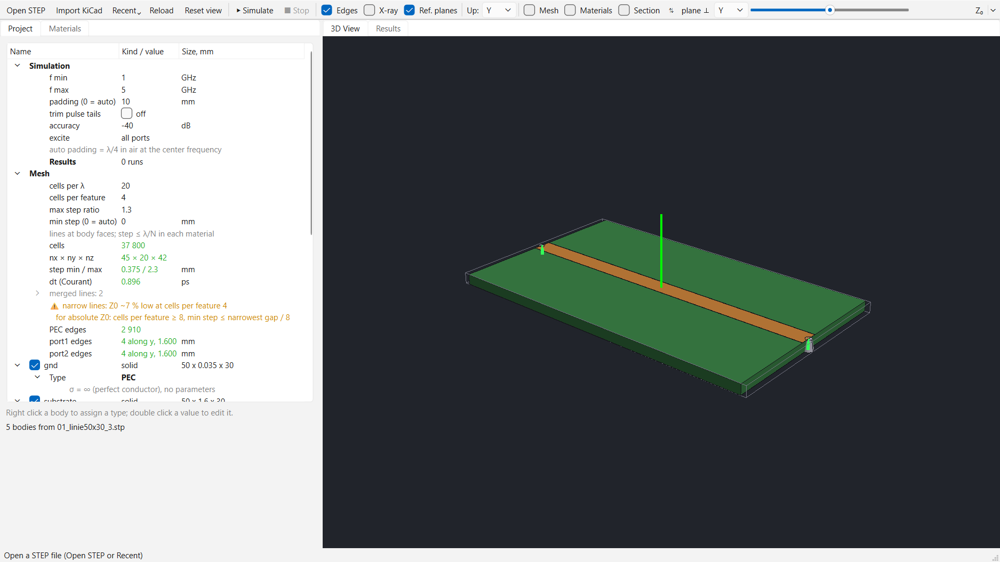
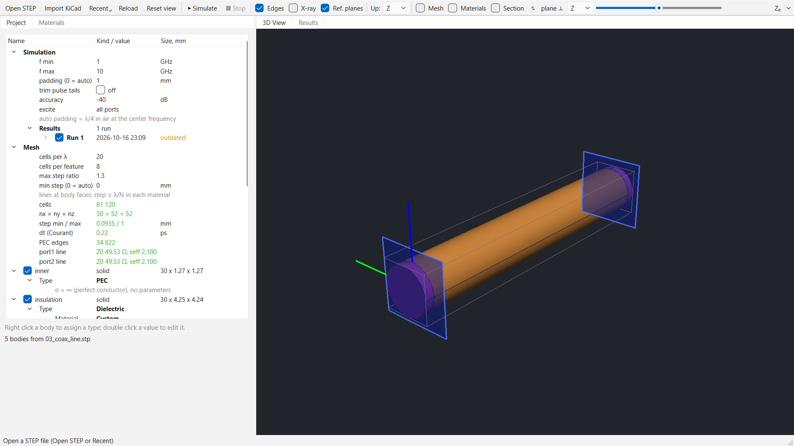
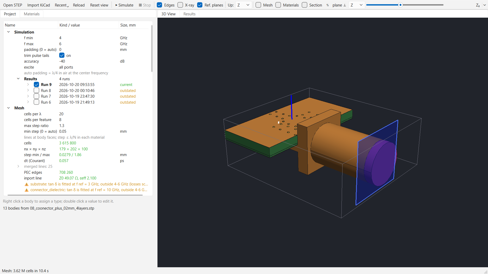
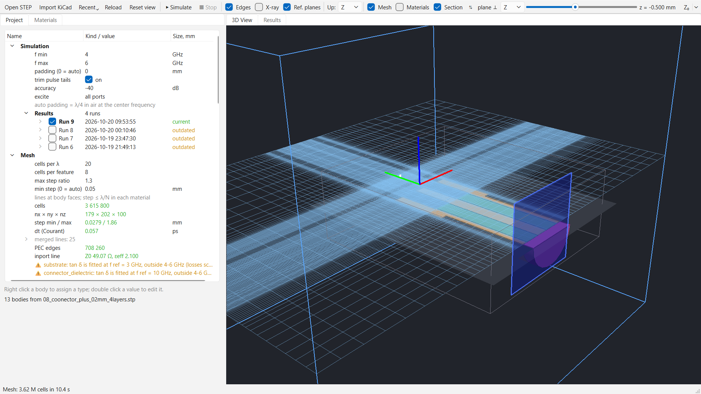
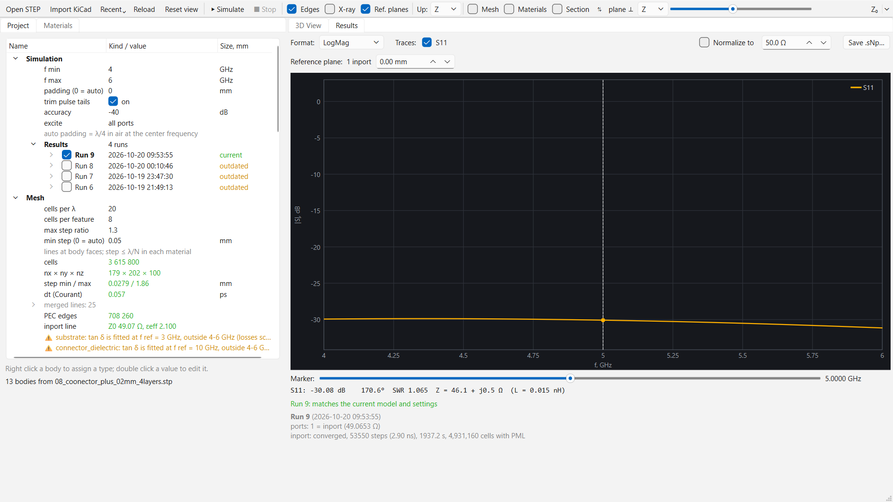
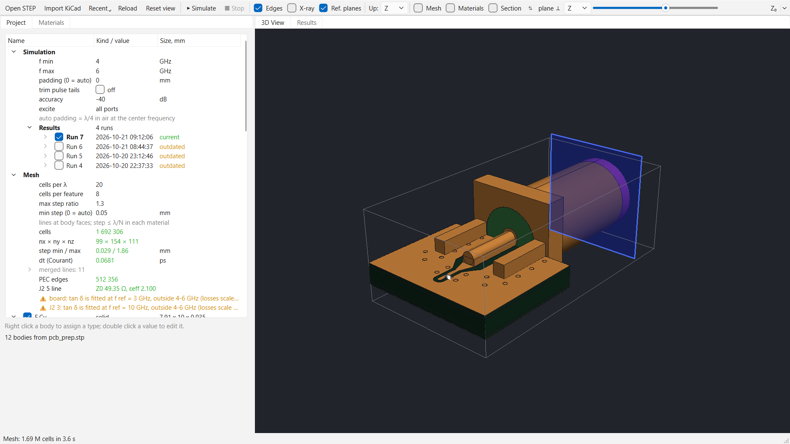
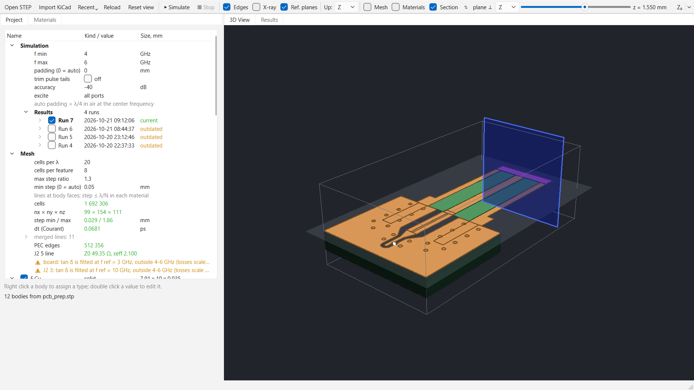
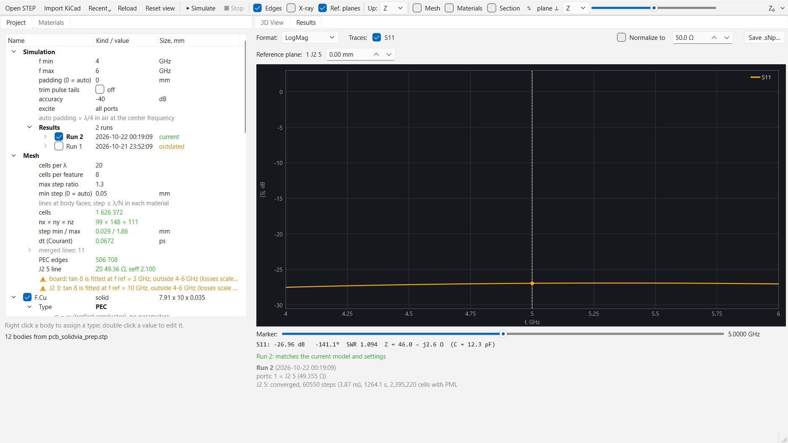
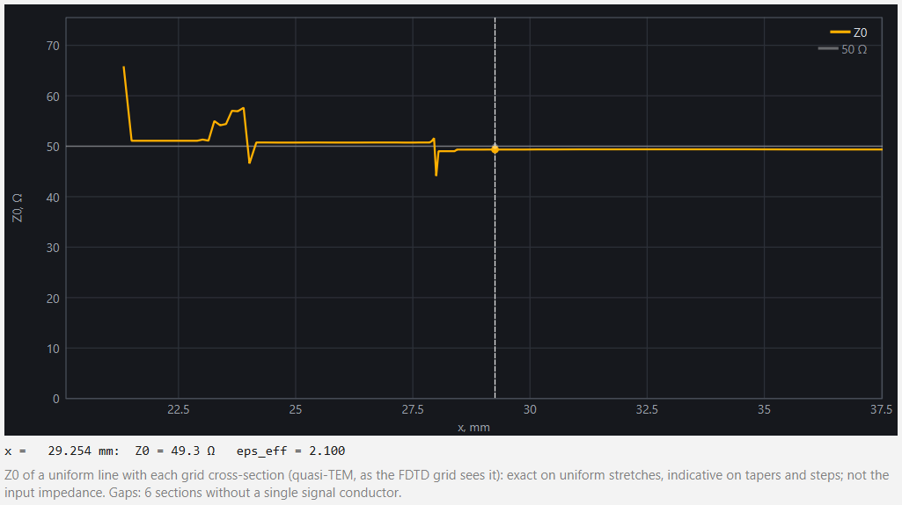
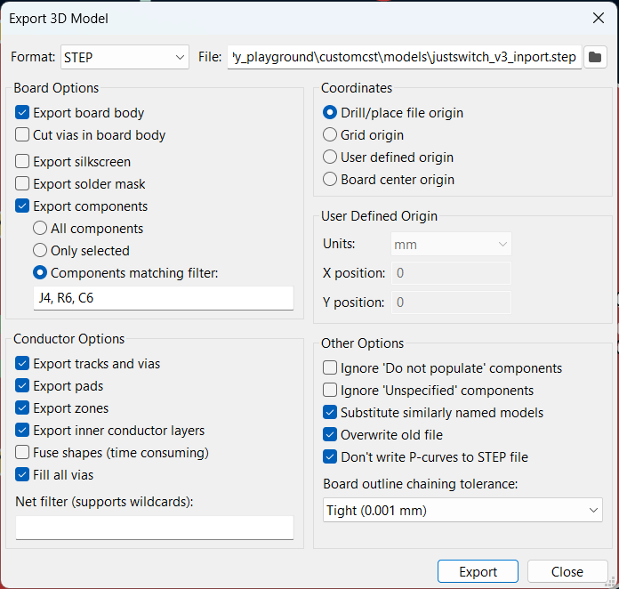

# customcst

> **Note:** All the code in this project was written by Claude (Anthropic's AI).
> I acted as the meatbag consultant: ideas, models, feedback, "this looks
> wrong", and taste.

## Overview

customcst is an attempt to reproduce a part of CST Studio's workflow from
scratch: open a STEP model, assign materials and ports to its bodies, mesh
it, run a 3D FDTD simulation and look at S11, the way CST's time-domain
solver does it.

It grew out of [`pseudo_cst_3d`](../pseudo_cst_3d), a playground for building
intuition about fields on uniform grids with toy models. customcst is the
second, more serious pass:
- real CAD geometry;
- real units;
- a non-uniform rectilinear grid like CST's hexahedral mesh;
- results that can be compared with a calculator and a VNA.

The target so far has been feed lines: an SMA connector on a 4-layer PCB, a
grounded coplanar line, a 50 Ω load at its end. The question is how well it
all is matched.

**What is not there yet:**
- far field and the other antenna quantities (pattern, gain, efficiency);
- field visualization (DFT field monitors on slices);
- wideband dispersive dielectrics.

**What is there** is the foundation these need. It works and is checked
numerically:
- the STEP import;
- the project model;
- the mesher;
- the discretization into the Yee grid;
- the FDTD solver with CPML, ports and lumped elements;
- the S-parameter extraction.

The fields already live on the grid. Far field and field views are the next
levels on top, not a rewrite.

## Models we worked through

**A microstrip line**: the first model, with two discrete ports.



**A coaxial line** with a waveguide port at each end (blue: the reference
planes). Z0 from the 2D port solver: 49.5 Ω.



**An SMA connector on a 4-layer board**: drawn in Inventor; a coplanar line
with vias to a 50 Ω lumped load. The waveguide port sits on the connector's
coax.



**The same model in section**, with the compute grid shown on the plane.



**Its S11**: about −30 dB over 4–6 GHz, with the marker readout (SWR, Z, the
equivalent L or C).



**The same board drawn in KiCad** and imported from its STEP export:
- the copper is merged per layer and the pads are cut to the copper;
- the vias become one body;
- the connector is a separate STEP model.



**The KiCad board cut at the top copper**: the trace, the pour, the via
fence and the lumped load in the clearance slot.



**The KiCad board's S11**: about −27 dB over 4–6 GHz on the same mesh
settings, within a couple of dB of the Inventor model above.



**The Z0 profile along the line**: the line impedance at every grid plane.
It shows which part of the feed is off 50 Ω.



**The Z0 profile along a drawn path**: click the path along the trace in
the 3D view (the plane in blue), and every cross-section is cut square to
it, through the bends and diagonals. Here a KiCad board from the
connector to the switch; the green window is what the section under the
profile's marker takes in.


**TDR on the Z0 profile**: the time domain transform of the runs' S11,
like a VNA's, laid on the profile's own axis (the time from each
section's eps_eff). Where each run reflects, next to the profile and to
what a TDR would see of the profile alone. Here the justswitch input:
the switch pin's reflection at the path's end shrinks from run to run.


## Features

- **STEP import** (OpenCASCADE). Bodies keep their CAD names and colors.
  Through holes are found and can be filled as vias.
- **KiCad import**: a KiCad board STEP becomes a clean model. There is one
  body per copper layer, with the pads merged in, plus the vias and the
  board. Every via, and every plated hole in a footprint, becomes a solid
  through cylinder of its drill: blind and buried vias are not modeled
  yet. The pads and vias of footprints left outside the board are
  dropped. Re-importing an updated board keeps the assignments of the
  surviving bodies.
- **Project file next to the model** (`model.step` → `model.toml`):
  - body types: PEC, dielectric, discrete port, waveguide port, lumped
    element;
  - a material library (FR4, PTFE, …, with εr and tan δ);
  - frequency range and mesh settings.
- **Non-uniform rectilinear mesh**:
  - lines at the body faces;
  - a step of at most λ/N in each material;
  - a number of cells per feature;
  - a finer step around slanted metal (a 45° trace), sized by its gap;
  - a grading limit.
- **Background discretization** with progress: staircase materials on the
  Yee grid, with PEC edges and a closure of thin metal.
- **3D FDTD solver**:
  - CPML;
  - numba kernels on all cores, with a numpy fallback;
  - stops at a given energy level.
- **Ports**:
  - discrete ports, with a resistance;
  - waveguide ports, which use the line's own quasi-TEM mode from a 2D
    solver. Cylinders work for coax and boxes for PCB lines.
- **Lumped R, L, C**, series or parallel, drawn as a cylinder across a gap.
- **Results**:
  - S11 as LogMag, phase, SWR, Smith chart or Z;
  - a marker readout;
  - reference-plane shift;
  - renormalization to any impedance;
  - Touchstone `.sNp` export;
  - every run is saved, can be compared with the others, and is marked
    outdated when the model changes.
- **TDR** of the shown runs: low pass (step as Z, impulse) with a causal
  continuation to DC, or band pass; on a Z0 profile's axis, with the
  profile as a TDR would see it.
- **Line impedance tools**:
  - Z0 at any grid plane;
  - a Z0 profile along an axis;
  - a Z0 profile along a path drawn in the model (one per project, kept in
    its file): cross-sections square to it, on a fine grid of their own;
  - computed profiles are saved with the runs: a model reopened unchanged
    shows them without computing again;
  - Z0 convergence at a plane: the plane alone on finer and finer grids,
    the converged value and how far the current 3D grid is from it;
  - an accuracy note for narrow gaps.
- **3D view**:
  - CAD-style trackball navigation;
  - standard views (top, bottom, front, back, left, right, iso) and an
    orthographic projection, from buttons over the view;
  - edges and X-ray modes;
  - a section plane;
  - the mesh plane;
  - material colors;
  - reference planes.
- **Numerical checks** (`checks/`) for every level: the mesh, discretization,
  port modes, the FDTD against analytic lines and a cavity, lumped elements,
  vias, the KiCad import.

## Exporting a board from KiCad

1. **Cut the board to what is simulated.** Draw an Edge.Cuts outline
   around the part of the board the run needs: the connector, the line,
   the chip's pin and the ground around them. Remove the copper outside it
   (tracks, zones beyond the outline) and refill the zones (B), so the
   pours end at the outline. The import drops footprints' pads and vias
   left outside the outline, but only reports other copper outside it,
   it does not cut it.
2. **Export the STEP**: File > Export > STEP, with these settings:

   

   - Board options: Export board body on; Cut vias in board body off (the
     import makes every via a solid copper cylinder); silkscreen and
     solder mask off (not modeled).
   - Export components: only the ones that belong in the model (Components
     matching filter): the connector, whose 3D model gives the coax, and
     the parts whose 3D models are the lumped elements' cylinders. On the
     justswitch board: `J4, R6, C6`.
   - Conductor options: tracks and vias, pads, zones, inner conductor
     layers on; Fill all vias on; Fuse shapes off (the import fuses each
     layer itself, faster).
   - Coordinates: Drill/place file origin, so every re-export lands at the
     same coordinates (the project's Z0 path, view and planes stay valid).
   - Other options: Substitute similarly named models, Overwrite old file
     and Don't write P-curves on; board outline chaining tolerance Tight
     (0.001 mm).
3. **Import it**: Toolbar > Import KiCad turns `board.step` into
   `board_prep.stp` with its project file. A re-export imported again keeps
   the types of the bodies that are still there and reports what changed.

## Running

```bash
pip install -r requirements.txt
python main.py                    # the last model opened
python main.py models/03_coax_line.stp
python checks/check_fdtd_line.py  # any check
```

The architecture, the design decisions and the plan are in
[ARCHITECTURE.md](ARCHITECTURE.md).

## License

Public domain: [The Unlicense](../LICENSE).
